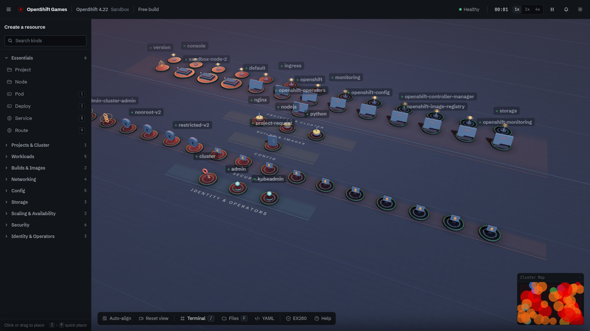

# OpenShift Games

**Learn Red Hat OpenShift by playing. Built for EX280.**

OpenShift Games is a browser-based 3D OpenShift cluster simulator. Create Projects with real
`oc` commands, deploy applications, expose Routes, run S2I builds, configure SCCs, RBAC, quotas and
Operators — then investigate and fix realistic production incidents. No install, no signup, no build
step: every lab runs client-side in your browser.

**Play:** https://shifting.pro · **Draw:** https://shifting.pro/draw

**Documentation:** the learner-facing guides live in the
[GitHub wiki](https://github.com/G-man3207/openshiftgames/wiki) — start with the
[EX280 Study Guide](https://github.com/G-man3207/openshiftgames/wiki/EX280-Study-Guide) and the
[EX280 Prep mode](https://github.com/G-man3207/openshiftgames/wiki/Exam-Prep) reference. The engineering
docs (architecture map, conversion spec, declarative engine, research notes, verification report) stay in
[`docs/`](docs/).

Target platform: **Red Hat OpenShift Container Platform 4.22** (Kubernetes 1.35, CRI-O) · Exam: **EX280V422**
(Red Hat Certified Specialist in OpenShift Administration).



---

## Features

- **`oc` terminal** — a simulated OpenShift CLI with `get`, `describe`, `apply -f`, `create`,
  `new-app`, `new-project`, `expose`, `create route`, `start-build`, `set env|image|resources`,
  `rollout`, `logs`, `adm policy` (RBAC + SCC), `auth can-i`, `adm top`, `adm cordon|drain`,
  `create quota|limitrange|clusterquota`, `process`, `helm`, `htpasswd`, pipes and output redirects.
  `oc` is the taught command; a leading `kubectl` is accepted as an alias with an educational hint.
- **First-class OpenShift resources** — Project, Pod, Deployment, ReplicaSet, StatefulSet, DaemonSet,
  Job, CronJob, Service, Route, Ingress, NetworkPolicy, ConfigMap, Secret, PVC, PV, StorageClass,
  HPA, PDB, ResourceQuota, LimitRange, ClusterResourceQuota, ServiceAccount, Role, RoleBinding,
  ClusterRole, ClusterRoleBinding, SCC, BuildConfig, Build, ImageStream, Template, Subscription
  (Operator), User, Group, ClusterOperator, ClusterVersion, IPAddressPool, L2Advertisement.
  A single central registry (`js/data/kindRegistry.js`) drives the palette, 3D renderer, inspector,
  command bar, minimap and YAML export.
- **S2I builds & ImageStreams** — `oc new-app`, BuildConfig → Build → ImageStream lifecycle, image
  change triggers and rollouts, internal registry image references.
- **Routes & networking** — `oc expose svc/...`, edge/passthrough/reencrypt TLS Routes, Route
  admission state, Services, NetworkPolicies, MetalLB `LoadBalancer` services with EXTERNAL-IP.
- **Declarative workflows** — a Files panel with editable YAML manifests, `oc apply -f`,
  Kustomize base/overlays (`oc apply -k`), OpenShift templates (`oc process -f … | oc apply -f -`),
  Helm charts (`helm install|upgrade|uninstall`) and an `htpasswd` file for identity labs.
- **Security & identity** — HTPasswd identity provider + `oc login`, users/groups/identities, RBAC
  evaluation (`oc auth can-i`, `oc adm policy add-role-to-user`), SCC grants
  (`oc adm policy add-scc-to-user`), privileged-pod denial with real `Forbidden` semantics.
- **Quotas & self-service** — Namespace/Project quotas, LimitRanges, ClusterResourceQuota, project
  templates and self-provisioner concepts.
- **Operators (OLM)** — Subscriptions install through CSV phases (`Installing → Succeeded`), then
  affect the cluster (e.g. MetalLB provides LoadBalancer IPs); uninstall by deleting the Subscription.
- **20-level EX280 campaign (5 chapters)** — Manage OpenShift → Declarative & Kustomize →
  Deploy & Expose → Identity, RBAC & Self-service → Security & Operations, ending in a production
  platform build.
- **12 timed EX280 labs** — speed drills: three-tier app, CrashLoopBackOff, edge TLS Routes,
  Kustomize prod overlay, source-to-image, quota guardrail, RBAC onboarding, SCC, network isolation,
  operator install, HTPasswd onboarding and an EX280 speed run.
- **EX280 Prep mode** — objective tracker for the official EX280V422 objective groups (with Red Hat
  docs links), quick command labs, a searchable `oc` cheat sheet, exam facts and a readiness verdict.
- **Chaos mode** — endless incident survival; **Sandbox** — free build scored 0–100 by the
  Architecture Advisor (HA, security, networking, storage, scaling, RBAC, quotas, probes, config, cost).
- **A start page worth opening** — a dark, premium landing screen with the live 3D cluster in the
  hero: a banded mode launcher, an interactive EX280 objective→drill picker built from the real
  objective data, real product captures, and a light colophon that credits K8s Games by Rohit
  (Apache-2.0), the project this one is a derivative of. Native page scrolling, 390px responsive,
  `prefers-reduced-motion` support and a progress-aware primary action.
- **3D cluster view** — Three.js r152 diorama with redesigned models for all 42 kinds, studio
  lighting, floor tier zones, camera fit-to-view, a screen-space label layer with collision culling,
  ownership/network/traffic connections, project floor planes, minimap, inspector, live metrics and
  an importable/exportable YAML view. The renderer boots as the start-page hero and expands to full
  screen when a mode launches.
- **OpenShift Draw** (`/draw`) — a 3D architecture whiteboard: drag OpenShift resources, draw
  connections, edit properties, auto-layout, export YAML/PNG and share via URL.

---

## How to play

1. Pick a mode on the start page — **Campaign**, **Timed Labs**, **Sandbox**, **Chaos** — or open
   **EX280 Prep** for the objective tracker. The start page also maps each EX280 objective group to
   the campaign level and timed lab that drills it.
2. Create resources from the left palette or with the `oc` terminal (`/`). The name prompt lets you
   match the objective name (e.g. `frontend`).
3. Click a resource to inspect it (Overview / YAML / Describe / Events); right-click for actions.
4. Press `/` to open the `oc` terminal, `F` for the Files panel, `?` for EX280 Prep, `H` for help.
5. Handle incidents as they appear — diagnose with `oc describe`, `oc logs`, `oc get events` — and
   resolve them by fixing the resource state.

### Controls

| Input | Action |
|-------|--------|
| `/` | `oc` command bar |
| `F` | Files / manifests panel (`apply -f`, `apply -k`, templates, Helm) |
| `?` | EX280 Prep (objective tracker, quick labs, cheat sheet) |
| `H` | Help / How to play |
| `Space` | Pause / resume the simulation |
| `M` | Metrics dashboard |
| `Esc` | Close panel / open the pause menu (Resume, Restart, Main menu) |
| `1–9` | Quick-select a palette resource |
| Left-click | Select resource |
| Left-drag | Move resource or rotate camera |
| Right-click | Context menu (Expose, Start Build, Scale, Rollout, Delete, …) |
| Right-drag | Pan camera |
| Scroll | Zoom |

Bottom toolbar: **Auto-Align** | **Reset View** | **YAML** | **Files** | **EX280** | **Help**.

---

## EX280 coverage

The game is organised around the official EX280V422 objective groups. Every campaign level maps to
one or more exam objectives (level/challenge data carries `examObjectives` and `docsLinks`; the
in-app EX280 Prep tracker shows per-bullet coverage).

| EX280V422 objective group | Where it is practiced | Campaign chapter / labs |
|---|---|---|
| Manage OpenShift Container Platform (projects, `oc` CLI, querying, health) | Campaign ch. 1, Sandbox, `oc` terminal | Levels 1–4; Lab 1 |
| Declarative resource management (manifests, Kustomize, Helm, templates) | Files panel, `oc apply -f/-k`, `oc process`, `helm` | Levels 4–8 |
| Deploy applications (images, builds, ImageStreams, rollouts, scaling) | Builds/ImageStream controllers, `oc new-app`, `oc start-build`, `oc rollout` | Levels 9–10; Labs 3–5 |
| Manage authentication and authorization (HTPasswd, users, groups, RBAC) | `oc login`, users/groups, `oc adm policy`, `oc auth can-i` | Levels 13–16; Labs 7–8, 11 |
| Configure network security (Services, Routes, NetworkPolicy, non-HTTP/SNI) | Route admission, TLS edge/passthrough, default-deny NetworkPolicy | Levels 11–12; Labs 2–3, 9 |
| Expose non-HTTP / SNI applications | passthrough/reencrypt Routes, LoadBalancer services | Level 12; Lab 10 |
| Enable developer self-service (quotas, LimitRanges, project templates) | ResourceQuota/LimitRange/ClusterResourceQuota, templates | Level 15; Lab 6 |
| Manage OpenShift operators (OLM) | Subscription → CSV phases, operator effects, uninstall | Level 18; Labs 10 |
| Configure application security (SCCs, service accounts, privileged workloads) | SCC grants/denials, `oc set serviceaccount`, `oc debug` | Level 17; Lab 8 |
| Troubleshooting & operations (logs, events, top, cordon/drain, jobs) | Incidents, Chaos mode, Jobs/CronJobs | Levels 3, 19, 20; Labs 2, 6, 12 |

Official sources (verify against these before your exam):

- EX280 exam page: <https://www.redhat.com/en/services/training/red-hat-certified-openshift-administrator-exam>
- OpenShift Container Platform 4.22 documentation: <https://docs.redhat.com/en/documentation/openshift_container_platform/4.22>
- OpenShift 4.22 release notes: <https://docs.redhat.com/en/documentation/openshift_container_platform/4.22/html/release_notes>

> OpenShift Games is a study aid, not an exam dump. It simplifies cluster behaviour for teaching, and
> it is not affiliated with or endorsed by Red Hat.

---

## Run locally

There is **no build step** and no dependencies to install. The app is plain ES modules served
statically (Three.js and Tailwind are loaded from CDNs; an internet connection is required for
those, and a WebGL-capable browser is required for the 3D view).

```bash
git clone https://github.com/G-man3207/openshiftgames.git
cd openshiftgames
python3 -m http.server 8080
# open http://localhost:8080 for the game and http://localhost:8080/draw for the whiteboard
```

> Serve over HTTP (not `file://`) — ES modules, import maps and the optional Files/EX280 Prep panels
> rely on HTTP semantics (`/draw` is served by a static rewrite in production).

## Deploy

The repo is a static site and deploys to any static host. The canonical demo is https://shifting.pro (hosted on Vercel; point the domain at the Vercel project):

- Canonical URL: `https://shifting.pro` (used in `og:url` / `og:image` / canonical tags;
  update `index.html`, `draw.html`, `og-image.html` and README if the domain changes).
- `vercel.json` keeps the `/draw` → `/draw.html` rewrite, cache headers and bot policy. No server
  code and no environment variables are required.
- Deploy with the Vercel dashboard (import the repo), add `shifting.pro` as the project domain, or use
  `vercel deploy` (Vercel CLI, optional).

---

## Architecture & tech

- **No build step** — vanilla ES modules + import maps. No bundler, no framework, no npm runtime
  dependencies. Tailwind is loaded from the CDN for utility classes; custom styling lives in
  `style.css` (in-game shell) and `start.css` (start page). Type is set in Schibsted Grotesk with
  JetBrains Mono reserved for real terminal/YAML code.
- **Three.js r152** (`https://unpkg.com/three@0.152.0/...`, pinned in the import map) powers the 3D
  cluster view and the whiteboard; WebGL is required.
- **Central kind registry** — `js/data/kindRegistry.js` is the single source of truth for kinds,
  apiVersions, scope, aliases, `oc get` columns, palette metadata, default specs, owner chains,
  explain text, minimap sizes and the shared manifest serializer. Adding a kind means adding one
  registry entry + a resource class + a mesh creator (+ optional controller/data changes).
- **Simulation** — `js/engine/SimulationTick.js` runs fixed-step OpenShift controllers: scheduler,
  Pod lifecycle, Deployments/ReplicaSets, StatefulSets, DaemonSets, Jobs/CronJobs, HPA, PVC binding,
  Services/endpoints, Routes (admission), BuildConfig→Build→ImageStream, Subscriptions/operators,
  MetalLB LoadBalancer IPs, SCC enforcement, LimitRange/ResourceQuota/ClusterResourceQuota,
  OAuth/HTPasswd, ClusterOperator health.
- **Command layer** — `js/ui/CommandBar.js` parses `oc` commands (with pipes/redirects and tab
  completion) and drives the same engine APIs as the UI.
- **Declarative engine** — `js/engine/YamlParser.js` + `js/engine/ManifestEngine.js` provide a
  virtual file system, YAML manifests, Kustomize overlays, OpenShift templates, Helm charts and
  HTPasswd file operations; `js/ui/ManifestPanel.js` is the Files panel.
- **UI** — StartMenu (the start page: live diorama stage, mode launcher, EX280 objective picker,
  scroll reveals), HUD, Inspector, ContextMenu, Metrics, Settings, Incidents, Minimap, docked `oc`
  terminal and pause overlay; `index.html` wires the shell and the palette (generated from the
  registry); `draw.html` is the whiteboard.
- **Data** — `js/data/CampaignLevels.js`, `js/data/IncidentDefs.js`, `js/data/Achievements.js`,
  `js/data/EX280Objectives.js`, `js/data/ManifestFiles.js`.

Repo layout:

```
index.html            start page markup + game shell (inline ES module)
draw.html             OpenShift Draw whiteboard
style.css             in-game design system and shell styling
start.css             start page styling (dark editorial, one accent)
img/start/            product captures used by the start page
js/data/              kind registry, campaign levels, incidents, achievements, EX280 objectives,
                      manifest files
js/engine/            GameEngine, ClusterState, SimulationTick, IncidentEngine, ScoringEngine,
                      YamlParser, ManifestEngine, ObjectiveEvaluator, RBAC helpers
js/resources/         ResourceBase + per-kind classes (OpenShift + legacy)
js/rendering/         Three.js renderer, meshes, connection lines, particles, label layer
js/ui/                CommandBar, HUD, Inspector, ContextMenu, Metrics, IncidentPanel, Minimap,
                      Settings, ManifestPanel, StartMenu
js/modes/             CampaignMode, ChallengeMode, ChaosMode, SandboxMode, ExamPrepMode
vercel.json           static hosting: /draw rewrite + cache/bot headers
og-image.html         OpenGraph card source (1200×630) — PNG regenerated by the verifier
```

---

## Contributing

This is an education project. Useful contributions:

- Fix an inaccurate `oc` command/flag (cite the OpenShift 4.22 docs page in the PR).
- Add a campaign level, timed lab or incident aligned to an EX280 objective.
- Improve an EX280 Prep objective mapping or quick lab.
- Report a bug with browser, mode, level and the exact `oc` command/output.

Please keep the no-build, dependency-free architecture (`scripts/verify.mjs` checks syntax, imports,
registry consistency and forbidden legacy strings). Do not add npm dependencies.

---

## Credits & license

OpenShift Games is a derivative work of **K8s Games** by Rohit (`rohitg00`), used under the
Apache License 2.0.

- Original project: <https://github.com/rohitg00/k8sgames>
- Original copyright: **K8s Games, Copyright (c) Rohit G / rohitg00**, Apache-2.0.
- See the [NOTICE](NOTICE) file for the derivative-work statement and full attribution.

This project is licensed under the **Apache License 2.0** — see [LICENSE](LICENSE). The original
license and copyright notices are preserved. It is an independent, unofficial study project: it is
not affiliated with, sponsored or endorsed by Red Hat, Inc. OpenShift, Red Hat and the Red Hat logo
are trademarks of Red Hat, Inc. Kubernetes is a trademark of The Linux Foundation.
